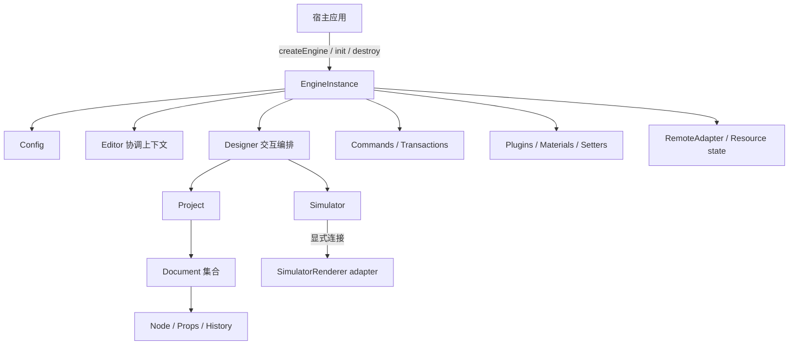

# 编排模块

编排模块解决的不是“如何渲染一个组件”，而是**谁拥有编辑器状态、一次变更如何进入模型、各子系统按什么顺序启动和退出**。在当前框架基线中，宿主通过 `@easy-editor/core/instance` 创建一个 `EngineInstance`，并对该实例的完整生命周期负责。

:::info 当前发布范围
本页只描述框架内核。`agentRestricted` 是现有信任策略预设的名称，不代表启用了 Agent Runtime。Agent 的运行时、传输、授权与审批协议已延后，不属于当前基线的公开入口或稳定承诺。
:::

## 1. 职责与非职责

编排模块负责：

- 建立 `EngineInstance` 到 Config、Editor、Designer、Project、插件、物料、设置器、命令和远程资源的所有权关系；
- 执行 `init()` / `destroy()` 状态机，并在失败时回滚或保留可重试的清理状态；
- 在 Project、Document、Node 之间维护单实例、单代际的对象图；
- 把外部 Schema 和编辑命令送入验证、信任策略与事务边界；
- 协调 Designer、Simulator 与具体渲染器适配器，而不把渲染框架写入内核模型；
- 在销毁时撤销监听器、热键、插件 Context、文档、物料、设置器和远程资源。

编排模块不负责：

- 把 React、Vue 或其他框架组件直接渲染到 DOM；
- 把同 Realm 插件或表达式执行变成安全沙箱；
- 替宿主完成认证、租户授权、持久化或网络 allowlist；
- 承载当前阶段尚未发布的 Agent Runtime。

## 2. 对象图与所有权



| 所有者 | 被拥有对象 | 规则 |
| --- | --- | --- |
| 宿主 | `EngineInstance` | 宿主决定创建时机，等待初始化，并保证最终等待销毁 |
| Engine | Config、Editor、Designer、插件、物料、设置器、命令、远程状态 | 子服务不能脱离 Engine 单独声明生命周期 |
| Designer | 选择、拖拽、检测、设置面板投影 | 交互状态只服务所属 Engine，不跨实例共享 |
| Project | Document 集合与当前文档 | `load` 是替换而不是合并；旧文档进入终止状态 |
| Document | Node 图、History、文档级事件 | Node 只能属于一个 Document，事务只能绑定一个目标文档 |
| Simulator / 运行与预览画布适配器 | 画布连接、DOM root 与渲染期订阅 | 挂载和释放必须成对，且不取得模型写权限；`SettingRenderer` 的直接 `SettingField` 写入仅是 `legacyTrusted` 兼容例外，新写入应进入命令与事务 |

Engine 的根服务可能在一次销毁后被重新启用，但**旧代派生对象不会复活**。旧 `Document`、`Node`、`History`、`ComponentMeta`、`PluginContext` 和回调参数都与创建它们的代际绑定；重新 `init()` 后必须重新获取引用。

## 3. 生命周期协议

```text
created --init()--> initializing --success--> ready --destroy()--> disposing --success--> disposed
initializing --rollback complete--> created
initializing --rollback incomplete--> failed
created --destroy()--> disposing
disposing --cleanup failure--> failed
failed --destroy() retry--> disposing
disposed --explicit init()--> initializing
```

`disposed` 是一代资源的终点，而不是 Engine 实例的终点：宿主可以显式再次调用 `init()` 创建新一代。初始化失败且回滚完整时返回 `created`；回滚或销毁不完整时进入 `failed`，必须先重试 `destroy()`，不能直接重新初始化。

推荐的宿主流程是：

```ts
import { createEngine } from '@easy-editor/core/instance'

const engine = createEngine({
  hostWindow: window,
  trustPolicy: 'agentRestricted',
})

try {
  await engine.init({ designMode: 'design' })
  engine.loadProject(projectSchema, true)
} finally {
  await engine.destroy()
}
```

生命周期不变量：

1. `init()` / `destroy()` 进行中时不接受新的生命周期调用；调用方等待当前调用 settle 后再显式重试。
2. 初始化失败会逆序清理已经获得的资源；若清理也失败，实例进入 `failed`。
3. 销毁失败不会伪装为成功；再次 `destroy()` 会重试尚未完成的清理。
4. `ready.init()` 与 `disposed.destroy()` 是 no-op，不会悄悄应用新配置或创建新代。
5. 销毁 Engine 时先停止渲染代，再销毁插件和 Designer，随后清理模型与其余根服务。
6. 插件和 `RemoteAdapter` 的生命周期回调不得重入同一 Engine 的 `init()` / `destroy()`。

不要直接调用 `materials.dispose()`、`setters.dispose()`、`project.purge()` 等子服务清理方法。它们的清理权限属于 Engine，公共宿主只负责 `engine.destroy()`。

## 4. 数据进入与变更路径

### 4.1 项目载入

```text
输入 Schema
  -> 结构检查
  -> 信任策略检查
  -> 版本检查与迁移
  -> 当前版本验证
  -> 规范化
  -> 构造候选 Document 图
  -> 原子替换当前 Project
```

`engine.loadProject()` 是宿主拥有的写入口。验证失败发生在旧项目卸载之前；载入成功后，遗漏的 `id`、`config`、`meta` 或扩展字段不会从旧项目泄漏到新项目。

### 4.2 编辑命令

新的受约束集成应使用封闭的 typed command 目录：

```ts
const document = engine.project.currentDocument
if (!document) throw new Error('No active document')

engine.transactions.runOnDocument(document, [
  { type: 'updateProps', nodeId: 'title', props: { text: 'EasyEditor' } },
  { type: 'moveNode', nodeId: 'chart', parentId: 'content' },
])
```

命令会在副作用前验证类型、字段、节点身份和目标文档。一个批次只形成一个 History 单元：全部提交，或恢复 Schema、节点身份、选区、History、物料计数和延迟事件。

若模型已经提交、但提交后的观察者失败，Core 抛出 `TransactionCommittedError`，且 `committed === true`。宿主不能把它当作未执行而自动重试。

`Project`、`Document`、`Node` 仍暴露部分历史读写方法，以支持现有 Designer 和根入口迁移；这些方法是兼容面，不是受限宿主的新写权限。`agentRestricted` 下直接模型写入会被拒绝，`legacyTrusted` 才保留旧行为。

## 5. 观察与事件

读取状态应优先使用确定性、只读结果：

- `engine.lifecycleState`：生命周期判定源；
- `engine.project.export()`：当前项目的分离 Schema；
- `engine.materials.registry.getSnapshot()`：冻结、排序的物料快照；
- `engine.setters.getSettersMap()`：稳定的只读 Map facade；
- 插件 `PluginRegistry`：冻结的 runtime snapshot 和代际绑定导出；
- 事件订阅返回的 disposer：由注册方或 `PluginContext.onDispose()` 交还所有权。

事件回调是观察者，不是事务提交权。回调执行时不会借到宿主正在使用的模型写权限；事件参数也不应被缓存为跨代对象引用。

## 6. 稳定、兼容与内部边界

| 层级 | 当前定位 | 使用规则 |
| --- | --- | --- |
| `@easy-editor/core/instance` | 新框架稳定入口 | 通过 `createEngine()` 获取实例；依赖显式导出的类型和方法 |
| `EngineInstance` 上的 Designer / Project / Document 可读模型 | 渲染器与迁移兼容面 | 可读取和建立适配；不要把具体类构造器或原始写方法当作新扩展协议 |
| `@easy-editor/core` 根入口 | v1 兼容 facade | 仅用于渐进迁移；它持有进程级默认实例，不提供多实例隔离 |
| `packages/core/src/**`、边界 token、WeakMap、teardown helper | 内部实现 | 不深导入、不反射获取、不建立语义版本依赖 |

“TypeScript 中可见”不等于“稳定写权限”。`@easy-editor/core/instance` 有意保留部分渲染适配类型，但注释为兼容模型的字段不能绕过 Engine 的命令、事务和生命周期边界。

## 7. 信任边界

| 能力 | `agentRestricted` | `legacyTrusted` |
| --- | --- | --- |
| 可执行 Schema / callback transaction | 拒绝 | 允许 |
| 直接修改 Project / Document / Node | 拒绝 | 允许 |
| 插件原型扩展 | 拒绝 | 允许 |
| 远程访问 | 默认拒绝 | 仍需 `RemoteAdapter` 授权 |

两种策略都不是恶意代码沙箱。同 Realm 插件、物料回调、设置器组件、表达式 evaluator 和 `RemoteAdapter` 都必须被宿主视为受信代码。需要执行不可信扩展时，必须增加 Worker、iframe、隔离 Realm 或独立进程边界。

## 8. 扩展缝

- **插件**：通过有限 `PluginContext` 增加宿主行为、事件与只读导出；
- **物料**：注册组件实现和冻结的 `ComponentMetadata`；
- **设置器**：注册属性编辑 UI，但模型提交仍服从宿主信任策略；
- **渲染器**：通过 `SimulatorRenderer` 和具体框架 adapter 连接画布；
- **远程资源**：通过宿主 `RemoteAdapter` 在产生网络或 DOM 副作用前授权；
- **命令组合**：宿主组合已发布的 typed commands；当前不开放第三方命令类型注册。

Agent 不属于上述当前扩展缝；未来方案不能通过重新引入全局单例或绕过事务来反向污染框架内核。

## 9. 验证方式

编排契约主要由以下测试锁定：

| 不变量 | 测试族 |
| --- | --- |
| 实例隔离与导入安全 | `engine-instance`、`engine-constructor-boundary`、`import-safety` |
| 初始化、销毁、失败重试与代际 | `engine-lifecycle`、`engine-lifecycle-adversarial`、`engine-generation-boundary` |
| 子对象终止与引用边界 | `engine-child-boundaries`、`engine-reference-boundaries`、`node-disposal` |
| Schema 替换原子性 | `schema-validation`、`host-model-mutation` |
| 命令与事务回滚 | `transaction`、`transaction-boundary`、`structural-commands` |
| 受限写权限 | `restricted-mutation-authority`、`process-trust-boundary` |

除了运行时测试，还必须同时通过 Core lint、类型测试、构建和公共 API 基线检查。Dashboard 的浏览器生命周期测试负责验证真实挂载、`pagehide`、刷新、预览和销毁链。

## 10. 已知限制

- 当前 Dashboard 的部分 Designer 交互和设置器链仍依赖 `legacyTrusted` 兼容写法；它们不是受限宿主的参考实现。
- Core 尚未提供跨框架、无 DOM 假设的完整 Designer/Renderer SPI；当前交付的具体实现是 React。
- 同 Realm 中无法可靠识别生命周期回调在 `await` 之后通过预先捕获闭包发起的调用；这是扩展协议约束，不是可证明的隔离。
- 根入口默认 facade、旧 UMD 与进程级原型扩展可能产生跨实例副作用，只能作为迁移期能力。
- Agent Runtime 未纳入当前发布、验证或兼容承诺。

相关文档：[架构综述](/design/overview)、[插件系统](/design/plugin)、[渲染模块](/design/renderer)、[协议栈](/design/specs)。
