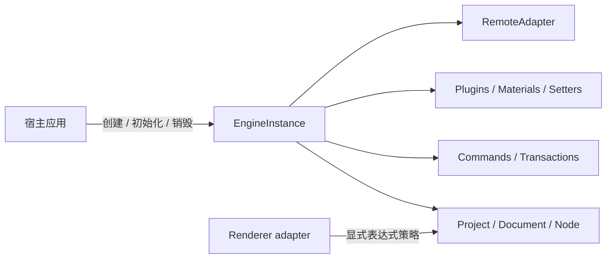

# 架构综述

EasyEditor 的内核不是一组全局单例，而应被理解为一个**由宿主通过工厂创建、拥有并销毁的状态机**。稳定框架面只来自 `@easy-editor/core/instance`；Schema、编辑命令、插件和远程资源只能通过显式边界获得有限权限。Agent Runtime 留待后续阶段单独规划。

## 1. 系统边界



边界的核心规则是：

1. **所有权先于访问权**：可变服务属于某个 `EngineInstance`，不能依赖隐式全局状态。
2. **验证先于副作用**：Schema、命令、插件依赖和远程访问必须先验证，再改变状态。
3. **一个事务只有一个结果**：批量命令要么整体提交并形成一个 undo 单元，要么回滚。
4. **能力小于对象引用**：插件 Context 和宿主 facade 只暴露完成职责所需的有限能力，不借出内核实现对象。
5. **销毁是协议**：所有资源都必须有所有者、可等待的清理结果和失败重试语义。

## 2. 显式实例与生命周期

新集成应从无默认实例副作用的入口创建引擎：

```ts
import { createEngine, type EngineInstance } from '@easy-editor/core/instance'

const engine: EngineInstance = createEngine({
  // 默认即 agentRestricted；这里显式书写以记录宿主选择。
  trustPolicy: 'agentRestricted',
  hostWindow: window,
})

try {
  await engine.init({ designMode: 'design' })
  engine.loadProject(projectSchema, true)
} finally {
  await engine.destroy()
}
```

生命周期状态为：

```text
created -> initializing -> ready -> disposing -> disposed
                     \-> failed -----^        \-> failed
```

- 任意生命周期操作进行中时，新的 `init()` / `destroy()` 都会立即抛出 `LifecycleReentrancyError`；调用方必须等待当前操作 settle 后显式重试。`ready.init()` 与 `disposed.destroy()` 是 no-op，不会应用新配置或开启新一代。
- 初始化失败会逆序回滚已拥有的资源。
- 销毁失败进入 `failed`，下一次 `destroy()` 会重试尚未成功的清理。
- 一个实例销毁不会清理另一个实例的 Project、事件、热键、物料或远程资源。
- `lifecycleState` 是只读判定源；`disposing`、`disposed`、`failed` 状态拒绝新增写入和监听器，不能通过外部改写状态重新打开边界。
- 一代从进入 `initializing` 开始，在进入 `disposing` 或初始化回滚时结束；只有代边界会使旧的异步写入票据失效。跨越销毁/重启才返回的插件注册、初始化或扩展结果不能提交到新代。
- Config、Editor、Designer 等实例根服务只会在显式 `init()` 后重新启用；旧代 `Document`、`History`、物料 Registry/Meta 和 PluginContext 引用会永久 tombstone，重启不会复活。PluginContext 暴露的是绑定当前代的 capability view，而不是可跨代复用的原始服务引用。
- 同代插件 `init()` / `destroy()` / `extend()` 调用共享进行中的 Promise；同名注册、覆盖、删除使用独占 reservation，候选插件先完成初始化，再原子替换已注册 runtime。
- 插件与 `RemoteAdapter` 的生命周期回调不得调用同一个引擎的 `init()` 或 `destroy()`；直接同步重入会抛出 `LifecycleReentrancyError`。受限 PluginContext 本身不暴露这两个方法。
- 销毁所需的内部清理权限不作为公共布尔参数暴露；引擎拥有的服务只能由 `EngineInstance.destroy()` 清理。宿主写权限会在事件、物料监听器和组件 Hook 执行前暂停，不能被回调借用。对外状态通知使用分离快照，不能保留内核 backing Map 或可变 Error 引用。
- 受限策略下，公开事务入口拒绝可执行 validator。物料事务会恢复完整 Entry/ComponentMeta 状态，提交后才 tombstone 被替换的 Meta；`MaterialRegistry.getSnapshot()` 只提供冻结、确定序的验证数据，不暴露回滚令牌。

`@easy-editor/core` 根入口仍保留 `defaultEngine`、`init`、`project` 等旧 facade 以兼容历史应用；新代码不应把它当作实例入口。

## 3. 信任策略不是沙箱

| 能力 | `agentRestricted` | `legacyTrusted` |
| --- | --- | --- |
| 直接修改原始模型 | 拒绝 | 兼容旧代码 |
| 可执行 Schema / 命令 | 拒绝 | 允许受信宿主 |
| 原型扩展插件 | 拒绝，并检查同 Realm 完整性 | 允许 |
| 远程访问 | 默认拒绝 | 允许，但仍需 `RemoteAdapter` 授权 |
| 适用场景 | 新的受约束宿主 | 依赖旧插件和 UMD 的 Dashboard |

`agentRestricted` 是 capability、输入校验和模型修改策略：受限 PluginContext 由有限根 facade 组成，不暴露引擎生命周期，也省略已知的反向权限字段；插件 registry 只读，宿主侧只读取冻结 runtime 快照和代际绑定导出。它用于缩小受支持 API 和误用面，不用于承载恶意代码。

插件与 `RemoteAdapter` 实现都在宿主 JavaScript Realm 中运行，因此是**受信扩展代码**。两种策略都不构成进程、iframe、Realm 或 SES 级安全隔离；插件仍可使用自己捕获的闭包、导入和全局对象。渲染器中的表达式执行也必须单独配置策略；允许执行不等于“在沙箱里执行”。

## 4. Schema 边界

当前规范版本是 `1.0.0`。载入顺序固定为：

```text
结构检查 -> 信任策略检查 -> 版本检查 -> 迁移 -> 当前版本验证 -> 规范化 -> 替换旧项目
```

- `0.0.1` 会显式迁移到 `1.0.0`。
- 未来版本、无迁移路径、缺少 `componentsTree`、循环引用、访问器和非普通对象会在卸载旧项目之前失败。
- `Project.load()` 是替换语义，不会继承上一个项目遗漏的 `id`、`config`、`meta` 或扩展字段。
- `SchemaValidator.prepareWithReport()` 返回迁移和规范化报告，不修改调用者输入。

## 5. 命令与事务

可验证写入应通过 `engine.commands` 或 `engine.transactions`：

```ts
engine.transactions.runOnDocument(
  documentId,
  [
    { type: 'updateProps', nodeId, props: { title: 'New title' } },
    { type: 'moveNode', nodeId, parentId },
  ],
  document => document.revision === expectedRevision,
)
```

规范命令目录包括：

- `insertNode`、`updateProps`、`removeNode`、`moveNode`
- `replace`、`insertBefore`、`insertAfter`、`wrap`、`unwrap`

本阶段的公共命令目录是有意关闭的：第三方插件不能注册新的内核命令类型。需要扩展写入时，应在宿主侧组合上述 typed commands 与事务，而不是把任意回调注入命令执行器。

事务在写入前验证命令、文档身份和前置条件；提交后只产生一个历史单元。失败会恢复 Schema、节点身份、选区、历史、物料计数和延迟事件。观察者错误不会伪装成“未提交”。

## 6. Agent 阶段暂缓

本阶段只冻结可实例化、可销毁、可验证、可事务化且信任边界明确的框架内核。此前 Agent 实验已从本发布线隔离，Core 不发布 `./agent` 或 `./agent-channel` 子路径；Agent Runtime、传输、授权和审批协议将在框架契约稳定后单独规划。

## 7. 远程资源与销毁

网络、脚本、样式、WebSocket、计时器和缓存应由一个 `RemoteAdapter` 或子资源作用域拥有：

1. 在 `fetch`、DOM 插入或打开 socket **之前**调用远程访问策略。
2. 将 AbortController、节点、socket 和 timer 注册到资源作用域。
3. `destroy()` 时先阻止新工作，再取消进行中工作，最后逆序清理。
4. 销毁后到达的异步结果必须被丢弃，不能重新注册资源。

`RemoteAdapter.init()` / `dispose()` 属于引擎拥有的生命周期回调，不能调用同一引擎的 `init()` / `destroy()`。直接同步重入会被拒绝；adapter 也不得捕获原始引擎引用并在 `await` 之后发起生命周期调用。

旧 UMD 脚本可能修改全局对象或原型；移除 `<script>` 标签不能撤销这些进程级副作用，因此只能在 `legacyTrusted` 同 Realm 中使用，并视为受信代码。销毁 Dashboard 后，同一 Realm 内也不会把已加载的 UMD 全局变量交给新实例复用；HMR 需要完整刷新页面。这是旧适配器的兼容限制，不是 Core 实例生命周期的保证。

## 8. 验证契约

核心不变量由以下测试族锁定：

| 契约 | 测试 |
| --- | --- |
| 实例隔离与生命周期 | `engine-instance`、`engine-lifecycle`、`engine-child-boundaries`、`engine-generation-boundary`、`engine-lifecycle-adversarial` |
| Schema 迁移与失败原子性 | `schema-validation` |
| 命令事务与结构命令 | `transaction`、`structural-commands` |
| 销毁并发与失败重试 | `disposal-ledger`、`lifecycle-disposal` |
| 有限公共入口与 capability 边界 | `framework-entry`、`engine-reference-boundaries`、`restricted-mutation-authority` |
| Dashboard 远程边界 | `dashboard-runtime-boundary` |

架构宣称只有在 lint、类型契约、运行时测试和构建同时通过时才成立。

## 9. 当前限制

- 当前仓库提供 React 渲染实现；其他框架是可扩展目标，不是已经交付的能力。
- 同 Realm 插件、`RemoteAdapter` 和 UMD 模块都是受信扩展代码；`agentRestricted` 与 `legacyTrusted` 都不是恶意代码沙箱。
- 同 Realm 表达式策略只能控制是否允许执行，不能隔离恶意代码。
- 同 Realm 中若不引入 AsyncContext 类因果跟踪或隔离 Realm/进程，引擎无法可靠区分“外部宿主调用”和“生命周期回调在 `await` 后通过原始闭包调用”。后者是插件/adapter 的宿主协议违规，不是内核能够承诺拦截的安全边界。
- Agent Runtime 的对象模型、传输与授权协议尚未纳入本阶段稳定承诺。
- 宿主仍需负责认证、租户授权、速率限制、持久化审计以及真正的进程/iframe 隔离。
