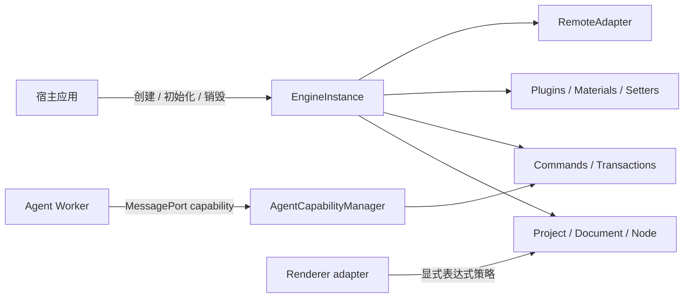

# 架构综述

EasyEditor 的内核不是一组全局单例，而应被理解为一个**由宿主创建、拥有并销毁的状态机**。Schema、编辑命令、插件、远程资源和 Agent 都只能通过显式边界获得有限权限。

## 1. 系统边界



边界的核心规则是：

1. **所有权先于访问权**：可变服务属于某个 `EngineInstance`，不能依赖隐式全局状态。
2. **验证先于副作用**：Schema、命令、插件依赖和远程访问必须先验证，再改变状态。
3. **一个事务只有一个结果**：批量命令要么整体提交并形成一个 undo 单元，要么回滚。
4. **能力小于对象引用**：不可信 Agent 获得可撤销 capability，而不是 `Project`、`Document` 或 `Node`。
5. **销毁是协议**：所有资源都必须有所有者、可等待的清理结果和失败重试语义。

## 2. 显式实例与生命周期

新集成应从无默认实例副作用的入口创建引擎：

```ts
import { createEngine, type EngineInstance } from '@easy-editor/core/instance'

const engine: EngineInstance = createEngine({
  // 默认即 agentRestricted；这里显式书写以记录宿主选择。
  trustPolicy: 'agentRestricted',
  hostWindow: window,
})

try {
  await engine.init({ designMode: 'design' })
  engine.loadProject(projectSchema, true)
} finally {
  await engine.destroy()
}
```

生命周期状态为：

```text
created -> initializing -> ready -> disposing -> disposed
                     \-> failed -----^        \-> failed
```

- 并发 `init()` / `destroy()` 会等待同一个进行中的操作。
- 初始化失败会逆序回滚已拥有的资源。
- 销毁失败进入 `failed`，下一次 `destroy()` 会重试尚未成功的清理。
- 一个实例销毁不会清理另一个实例的 Project、事件、热键、物料或远程资源。

`@easy-editor/core` 根入口仍保留 `defaultEngine`、`init`、`project` 等旧 facade 以兼容历史应用；新代码不应把它当作实例入口。

## 3. 信任策略不是沙箱

| 能力 | `agentRestricted` | `legacyTrusted` |
| --- | --- | --- |
| 直接修改原始模型 | 拒绝 | 兼容旧代码 |
| 可执行 Schema / 命令 | 拒绝 | 允许受信宿主 |
| 原型扩展插件 | 拒绝，并检查同 Realm 完整性 | 允许 |
| 远程访问 | 默认拒绝 | 允许，但仍需 `RemoteAdapter` 授权 |
| 适用场景 | 新的受约束宿主、Agent 能力端 | 依赖旧插件和 UMD 的 Dashboard |

两种策略都运行在 JavaScript 同一 Realm 中，**都不构成进程、iframe 或 SES 级安全隔离**。渲染器中的表达式执行也必须单独配置策略；关闭策略意味着不执行，而不是“在沙箱里执行”。

## 4. Schema 边界

当前规范版本是 `1.0.0`。载入顺序固定为：

```text
结构检查 -> 信任策略检查 -> 版本检查 -> 迁移 -> 当前版本验证 -> 规范化 -> 替换旧项目
```

- `0.0.1` 会显式迁移到 `1.0.0`。
- 未来版本、无迁移路径、缺少 `componentsTree`、循环引用、访问器和非普通对象会在卸载旧项目之前失败。
- `Project.load()` 是替换语义，不会继承上一个项目遗漏的 `id`、`config`、`meta` 或扩展字段。
- `SchemaValidator.prepareWithReport()` 返回迁移和规范化报告，不修改调用者输入。

## 5. 命令与事务

可验证写入应通过 `engine.commands` 或 `engine.transactions`：

```ts
engine.transactions.runOnDocument(
  documentId,
  [
    { type: 'updateProps', nodeId, props: { title: 'New title' } },
    { type: 'moveNode', nodeId, parentId },
  ],
  document => document.revision === expectedRevision,
)
```

规范命令目录包括：

- `insertNode`、`updateProps`、`removeNode`、`moveNode`
- `replace`、`insertBefore`、`insertAfter`、`wrap`、`unwrap`

事务在写入前验证命令、文档身份和前置条件；提交后只产生一个历史单元。失败会恢复 Schema、节点身份、选区、历史、物料计数和延迟事件。观察者错误不会伪装成“未提交”。

## 6. Agent 能力边界

Agent 不应在 UI 主线程持有引擎对象。推荐流向是：

```text
UI -> request DTO -> Worker
Worker -> snapshot capability -> 隐私投影 -> 同源 AI Gateway
Worker -> strict command parse -> preview -> safe proposal
UI -> 显式确认 -> trusted Host -> approveAndExecute
Host -> safe result DTO -> UI
```

宿主按请求签发最小 grant：允许的文档、组件、命令、额外字段和大小上限。组件类型、组件 prop 和额外字段是三组独立授权；prop/额外字段默认拒绝，只有通过递归值策略验证的有限字符串、有限数值或精确对象才可进入命令。Dashboard 当前只允许受限的 `Text.text`，并要求插入节点携带经过数值范围验证的 `$dashboard.rect`。

`preview` 固化 revision、生成 ID、effects 和预期结果；`execute(planId)` 在提交前检查 stale 状态，在提交后校验精确结果。Dashboard 的 Worker session 使用 `executionAuthority: 'host'`：peer 的 `execute` 会 fail-closed，只有可信宿主持有的 `approveAndExecute(planId)` 能提交。Host 按 plan ID 读取自己保存的权威 preview，再向 UI 派生命令数量、操作类型和受影响节点数量；Worker 不能用伪造 effects 替换确认摘要。UI 不会拿到 plan ID、节点 ID 或命令。拒绝、超时、关闭窗口和 stale 都不会静默重新 preview 或自动重试。由该入口产生的 receipt、audit record 和 committed event 都携带 `approvalSource: 'host'`；它只证明可信 Host 调用了批准入口，不证明某个具体用户的身份。

Dashboard 宿主只检查并复制最近 10 条消息，单条 UTF-8 上限 2 KiB、总计 12 KiB，并在创建 Worker 前拒绝越界输入。若执行错误表明已经提交或无法证明完整回滚，则返回 `outcome: unknown`；调用者必须重新读取画布，不能自动重试。

## 7. 远程资源与销毁

网络、脚本、样式、WebSocket、计时器和缓存应由一个 `RemoteAdapter` 或子资源作用域拥有：

1. 在 `fetch`、DOM 插入或打开 socket **之前**调用远程访问策略。
2. 将 AbortController、节点、socket 和 timer 注册到资源作用域。
3. `destroy()` 时先阻止新工作，再取消进行中工作，最后逆序清理。
4. 销毁后到达的异步结果必须被丢弃，不能重新注册资源。

旧 UMD 脚本可能修改全局对象或原型；移除 `<script>` 标签不能撤销这些进程级副作用，因此只能在 `legacyTrusted` 同 Realm 中使用，并视为受信代码。销毁 Dashboard 后，同一 Realm 内也不会把已加载的 UMD 全局变量交给新实例复用；HMR 需要完整刷新页面。这是旧适配器的兼容限制，不是 Core 实例生命周期的保证。

## 8. 验证契约

核心不变量由以下测试族锁定：

| 契约 | 测试 |
| --- | --- |
| 实例隔离与生命周期 | `engine-isolation`、`engine-lifecycle` |
| Schema 迁移与失败原子性 | `schema-validation` |
| 命令事务与结构命令 | `transaction`、`structural-commands` |
| Agent grant、stale 与传输 | `agent-*` |
| 销毁并发与失败重试 | `disposal-ledger`、`lifecycle-disposal` |
| Dashboard 远程/Worker 边界 | `dashboard-runtime-boundary`、`ai-chat-privacy` |

架构宣称只有在 lint、类型契约、运行时测试和构建同时通过时才成立。

## 9. 当前限制

- 当前仓库提供 React 渲染实现；其他框架是可扩展目标，不是已经交付的能力。
- `legacyTrusted` 插件和 UMD 模块不是可撤销沙箱。
- 同 Realm 表达式策略只能控制是否允许执行，不能隔离恶意代码。
- Agent capability 只能约束模型可执行的动作集合；Dashboard 的显式确认门用于核对用户意图，但不能消除画布文本中的提示注入，也不能保护已被 XSS 或恶意脚本控制的宿主 UI Realm。
- 宿主仍需负责认证、租户授权、速率限制、持久化审计以及真正的进程/iframe 隔离。
