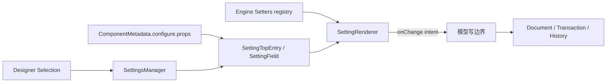

# 设置器模块

设置器把组件物料中的属性描述投影为编辑 UI。它由**物料配置、SettingField 状态投影、Setter 注册表和具体框架视图**四部分组成；Setter 组件本身不拥有 Project，也不应成为绕过事务的通用模型写入口。

:::info 当前发布范围
本页描述框架设置器协议。Agent 自动改参、审批和工具调用不属于当前设置器基线，也没有随本阶段发布。
:::

## 1. 数据流



各层职责：

| 层 | 主要对象 | 职责 |
| --- | --- | --- |
| 描述协议 | `FieldConfig`、`SetterConfig`、`FieldExtraProps` | 描述字段、分组、Setter 类型、默认值和兼容回调 |
| 状态投影 | `SettingsManager`、`SettingTopEntry`、`SettingField` | 根据选区生成字段树，读取多选值状态和属性路径 |
| 注册表 | `Setters`、`RegisteredSetter` | 将类型名解析为组件和默认 props，拥有注册数据 |
| 视图 | React `SettingRenderer` / `SettingSetter` | 选择 Setter 组件，组合 props，呈现空态和错误降级 |

## 2. Field 描述协议

物料通过 `ComponentMetadata.configure.props` 定义属性面板：

```ts
const metadata = {
  componentName: 'Text',
  configure: {
    props: [
      {
        name: 'text',
        title: '文本',
        setter: {
          componentName: 'StringSetter',
          props: { placeholder: '请输入' },
        },
      },
      {
        name: '#appearance',
        type: 'group',
        title: '外观',
        items: [{ name: 'color', setter: 'ColorSetter' }],
      },
    ],
  },
}
```

`name` 映射到节点属性路径；`type: 'group'` 组织字段但不天然产生模型属性。`setter` 可以是字符串、`SetterConfig` 或兼容性的动态函数。`FieldExtraProps` 可提供默认值、显示条件、get/set hook 和变量支持。

物料元数据的普通对象/数组会被分离、拥有并冻结，accessor 会被拒绝；函数与组件实现作为不透明能力保留身份。因此带函数的动态 Setter、`condition`、`getValue`、`setValue`、`onChange` 都是**受信物料代码**，不是数据协议沙箱。

## 3. 选区与 SettingField 所有权

`SettingsManager` 监听所属 Designer 的选区：

- 未选中节点时，若当前文档有 root，则使用 root 的 setting entry；
- 单选时复用 Node 自己拥有的 `SettingTopEntry`，避免同一节点出现平行字段对象；
- 多选同类组件时创建一次 manager 拥有的组合 entry；
- 多选不同组件时，当前 React 视图不计算字段交集，而是显示不支持状态；
- 选区、Document 或 Engine 代变化时，旧字段树被 purge。

`SettingField` 与 Node/Document 代际绑定。节点被删除或 Engine 销毁后，保留的 Field、items、事件和写方法进入终止状态；重新初始化必须重新从 `settingsManager.settings` 获取字段。

`valueState` 用于表达多选状态：

- `2`：单一一致值；
- `1`：结构相似但不完全相同；
- `0`：未设置；
- `-1`：存在多个不同值。

这组数字是现有兼容模型；新的跨框架 SPI 不应在没有版本化契约的情况下复制内部判断逻辑。

## 4. Setter 注册表

Engine 拥有一个 `Setters` 注册表：

```ts
engine.setters.registerSetter('StringSetter', {
  component: StringSetter,
  defaultProps: { allowClear: true },
})

const registered = engine.setters.getSetter('StringSetter')
const snapshot = engine.setters.getSettersMap()
```

注册规则：

1. 类型名是 registry key；默认不覆盖同名 Setter。
2. `{ overwrite: true }` 用于宿主显式替换单项注册。
3. 批量对象注册是原子的；任一条无效时恢复整个批次之前的状态。
4. 注册记录与其中的普通数据会复制并冻结，外部后续修改不会改变 registry。
5. 组件/函数是不可深复制的执行能力，保留原身份且必须受信。
6. `settersMap` / `getSettersMap()` 返回稳定 `ReadonlyMap` facade；`set`、`delete`、`clear` 均被拒绝。
7. Engine 销毁会清空注册内容；facade 身份稳定不代表数据跨代持久化。

当前没有面向普通扩展的逐项 unregister 协议。需要临时注册时，应让插件与 Engine 同生命周期，或在明确的宿主组合阶段完成注册。

## 5. Setter 组件契约

Setter 组件主要接收：

```ts
interface SetterProps<T> {
  field: SettingField
  selected: Node
  initialValue?: T
  value: T
  onChange(value: T): void
  onInitial(): void
  removeProp(): void
}
```

React `SettingSetter` 会把 registry 的 `defaultProps` 与 Field 配置合并，处理默认值、多值状态和缺失 Setter。找不到组件时渲染 placeholder，而不是让整个属性面板崩溃。

业务 Setter 应：

- 把输入值视为快照，不直接修改对象内部字段；
- 通过 `onChange` 表达新的完整值；
- 通过 `removeProp` 表达删除，而不是写入特殊哨兵值；
- 不缓存 `field` 或 `selected` 到下一次 Engine 代；
- 不在 render 阶段注册监听器、远程请求或全局副作用；
- 对计时器、订阅和弹层建立明确组件卸载清理。

## 6. 变更与信任规则

SettingField 的 `getValue` / `setValue` 等历史 API 会触达 Node 属性。当前内置 React `SettingRenderer` 直接调用这些 API，因此它属于**受信编辑器兼容链**：

- 现有 Dashboard 使用 `legacyTrusted`，保留直接模型写入；
- `agentRestricted` 下原始 Project/Document/Node 写权限被拒绝；
- 新的受限宿主应把 Setter 的 `onChange` 转换为 `updateProps` typed command，并在 Engine transaction 中提交；
- 物料的 `getValue`、`setValue`、`condition` 等回调执行时不会继承宿主事务正在持有的模型权限；
- Setter 或物料回调不得重入同一 Engine 的生命周期。

推荐的受限适配形态是：

```text
Setter view emits { documentId, nodeId, path, value }
  -> host validates intent
  -> engine.commands.execute(updateProps)
  -> one transaction / one History unit
  -> renderer observes committed state
```

不要把 Setter 组件当作可信边界。第三方 UI 组件仍在宿主 Realm 中运行，可以访问自身导入和全局对象；需要加载不可信设置器时，必须使用 iframe/Realm/进程隔离，并定义可序列化的值协议。

## 7. 稳定、兼容与内部边界

| 层级 | 当前定位 |
| --- | --- |
| 稳定注册面 | `Setters` 的 register/get/readonly map、`Setter`、`RegisteredSetter`、`SetterProps` |
| 物料描述面 | `FieldConfig`、`SetterConfig`、`DynamicSetter`；函数字段属于受信兼容能力 |
| Designer 兼容模型 | `SettingsManager`、`SettingField` 读写方法、数字 `valueState` |
| 框架视图实现 | React `SettingRenderer`、`SettingSetter` 和 placeholder |
| 内部实现 | backing Map、SettingTopEntry collector、字段拥有者、purge/teardown boundary |

外部代码不能通过借用原生 `Map.prototype.set`、反射属性或深导入内部文件获得 registry 写权限。

## 8. 扩展缝

- 注册新的 Setter 类型和默认 props；
- 在物料 `FieldConfig` 中选择 Setter 和配置字段分组；
- 通过 `customFieldItem` / `customFieldGroup` 改变 React 面板布局；
- 为其他框架实现独立 SettingRenderer，但复用受支持的 Field 读取协议；
- 在受限宿主中增加“Setter intent -> typed command”适配层。

不应扩展 backing registry、猴子补丁 `SettingField` 原型，或依赖内部 collector/session id。

## 9. 验证方式

| 契约 | 测试族 |
| --- | --- |
| 注册数据所有权与只读 Map | `setters-trust-boundary` |
| 批量注册原子性 | `setter-registration-atomic` |
| 多实例隔离和代际清空 | `engine-instance`、`engine-generation-boundary` |
| Field/Node 终止语义 | `node-disposal`、`engine-reference-boundaries` |
| 回调不能借用写权限或重入生命周期 | `restricted-mutation-authority` |
| React 缺失 Setter 降级 | `react-renderer/setting-setter-missing` |

发布检查还应覆盖类型声明、设置面板真实浏览器交互、undo/redo 单元以及 Engine 销毁后的监听器泄漏。

## 10. 已知限制

- 内置 React 设置面板仍是 `legacyTrusted` 兼容写链，尚未统一改造成 typed-command adapter。
- 多选不同组件暂不计算 Field 交集。
- Setter registry 没有普通公共逐项卸载 API。
- 动态 Setter 和 FieldExtraProps 回调保留可执行函数，不适合直接接收不可信远程元数据。
- 当前只提供 React SettingRenderer；跨框架一致性协议和 conformance tests 尚未冻结。
- Agent 自动改参和审批流程未随当前设置器基线发布。

使用示例见[自定义属性设置器](/guide/extension/setter)，信任模型见[架构综述](/design/overview)。
