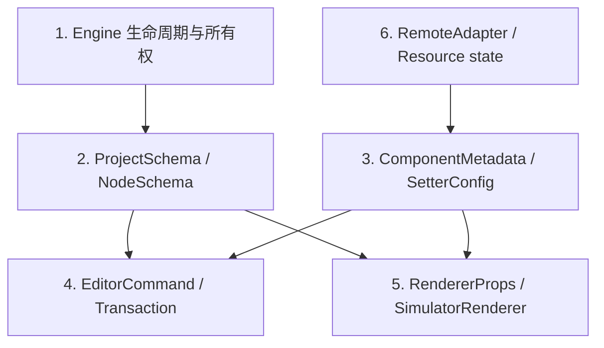

# 协议栈简介

EasyEditor 的“协议”不是一个无限扩展的 JSON 对象，而是一组位于不同信任层、具有不同版本和副作用规则的契约。当前框架基线把它们拆为**生命周期、项目 Schema、物料/设置器、编辑命令、渲染桥接和远程资源**六层。

:::info 当前发布范围
Agent Runtime、Agent transport、工具调用、授权与审批协议没有纳入本协议栈，也不随当前框架基线发布。未来 Agent 只能建立在这里已经验证的实例、事务和信任边界之上。
:::

## 1. 协议分层



| 层 | 主要入口 | 产生副作用前的门禁 |
| --- | --- | --- |
| 生命周期 | `createEngine()`、`init()`、`destroy()` | 状态转换、重入检查、代际票据 |
| Project Schema | `SchemaValidator`、`engine.loadProject()` | 结构、信任、版本、迁移、当前版本验证 |
| 物料/设置器 | materials / setters registry | 普通数据分离与冻结、registry 原子提交 |
| 编辑命令 | `engine.commands` / `engine.transactions` | 封闭类型目录、字段与身份校验、事务 precondition |
| 渲染桥接 | renderer packages、`ExpressionEvaluator` | 显式表达式策略、组件与上下文由宿主提供 |
| 远程资源 | `RemoteAdapter`、ResourceRegistry | trust policy + 宿主 adapter 双重授权 |

协议层不能互相替代：通过了 TypeScript 类型检查的 Schema 仍需运行时验证；通过了 Schema 验证也不等于其中的表达式可以安全执行；资源被登记也不等于 URL 已获授权。

## 2. 生命周期与所有权协议

稳定运行时入口是 `@easy-editor/core/instance`：

```ts
const engine = createEngine({ trustPolicy: 'agentRestricted' })
await engine.init()
try {
  engine.loadProject(schema, true)
} finally {
  await engine.destroy()
}
```

生命周期状态是 `created | initializing | ready | disposing | disposed | failed`。每个派生对象属于一个 Engine 和一个运行代；销毁后的引用不因重新 `init()` 而复活。

这层协议先于所有业务协议：没有明确 Engine 所有者、初始化点和销毁点的 Schema、插件或 renderer 集成，都不满足当前框架契约。

## 3. Project Schema 协议

当前版本：`1.0.0`。已注册的旧版本迁移：`0.0.1 -> 1.0.0`。

最小项目：

```ts
const schema: ProjectSchema = {
  version: '1.0.0',
  componentsMap: [],
  componentsTree: [
    {
      componentName: 'Page',
      docId: 'home',
      props: {},
      children: [],
    },
  ],
}
```

### 3.1 验证顺序

```text
plain object/array 与循环/accessor 检查
  -> 可执行值信任检查
  -> source version 检查
  -> 迁移到当前版本
  -> 当前版本结构验证
  -> 默认值规范化
  -> 分离输入
```

顺序是协议的一部分。未来版本、无迁移路径、缺少 `componentsTree`、错误的 componentName、循环引用、accessor 和非普通对象会在旧项目卸载之前失败。

`SchemaValidator.prepareWithReport()` 同时返回准备后的 Schema 和冻结报告：

- `sourceVersion` / `targetVersion`；
- 是否发生迁移及迁移记录；
- 规范化记录，例如缺失 `componentsMap` 时默认为空数组。

验证器不会修改调用者原始对象。`Project.load()` 是替换语义，不会继承上一个项目遗漏的 config、meta 或扩展字段。

### 3.2 可执行值

`RootSchema.methods`、`lifeCycles`、表达式 props 和 data source handler 可能包含 `JSExpression` / `JSFunction`。`agentRestricted` 下可执行 Schema 被拒绝；`legacyTrusted` 只表示宿主主动接受兼容风险，仍不构成沙箱。

## 4. 物料与设置器协议

`ComponentMetadata` 描述组件名、npm 信息、snippet、组件行为和属性配置；`FieldConfig` / `SetterConfig` 描述属性面板。

这一层允许组件函数和配置回调等不透明执行能力，因此与纯 Project Schema 的信任级别不同：

- 普通对象和数组由 registry 分离并冻结；
- accessor 被拒绝；
- 组件、函数和高级视图等能力保留身份；
- registry snapshot 不暴露可变 entry 或事务回滚 token；
- 远程物料必须先通过远程访问协议，再进入 registry。

不要把远端返回的任意 JSON/JavaScript 直接当作 `ComponentMetadata`。宿主需要校验包名、版本、来源和允许的执行能力。

## 5. 编辑命令协议

当前公共命令目录是封闭的：

| 命令 | 目标 |
| --- | --- |
| `insertNode` | 向 parent 插入新节点树 |
| `updateProps` | 更新节点 props 和/或 extras |
| `removeNode` | 删除非根节点 |
| `moveNode` | 移动现有节点到目标 parent |
| `replace` | 在原索引用新节点树替换非根节点 |
| `insertBefore` / `insertAfter` | 相对参考节点插入 |
| `wrap` | 用空 wrapper 包裹目标节点 |
| `unwrap` | 移除 wrapper 并原序提升 children |

运行时 validator 与 TypeScript union 共享同一命令目录，并拒绝未知字段。节点树检查 componentName、children、id 长度、重复 id 和循环结构；结构命令还检查 root、祖先关系、目标文档和 wrapper 约束。

所有 typed command 都绑定一个 Document。默认受限策略使用纯数据命令：

```ts
const result = engine.transactions.runOnDocument(documentId, commands)
```

受信兼容宿主还可以使用可执行 precondition：

```ts
// 仅适用于显式选择 legacyTrusted 的宿主。
const result = engine.transactions.runOnDocument(documentId, commands, {
  precondition(document) {
    if (document.mutationVersion !== expectedVersion) {
      throw new Error('stale document')
    }
  },
})
```

`precondition` / `postcondition` 是可执行 callback。默认 `agentRestricted` 会拒绝公开的可执行 validator；纯数据命令仍可使用。受限宿主当前没有原子的数据化 revision precondition；调用事务前的宿主检查只能降低陈旧写入风险，不能替代事务内校验。需要严格乐观并发时，应等待或实现经过安全评审的数据化条件协议，不能把任意函数伪装成数据。

一次事务只产生一个结果和一个 History 单元。失败会回滚模型、选择、History、物料状态和延迟事件。提交后的观察者错误通过 `TransactionCommittedError` 与真正回滚失败区分。

新增命令类型必须同时修改：类型目录、运行时 allowlist、字段 validator、apply 逻辑、事务回滚/历史测试和公共 API 基线。当前不支持插件在运行时注册命令处理器。

## 6. 渲染桥接协议

渲染器消费 `RootSchema | NodeSchema`、components map、`appHelper` 和显式 `ExpressionEvaluator`。设计态再通过 `SimulatorRenderer` 提供：

- rerender 与组件查找；
- 组件实例到 Node 的映射；
- DOM 节点与矩形查询；
- 自动重绘开关；
- run/dispose 生命周期。

这一接口当前带有 Web DOM 语义，是 Dashboard/React 设计态兼容桥，不是已经冻结的跨平台协议。真正的多框架 SPI 还需要独立的实例句柄、几何和事件 IR，以及跨实现 conformance tests。

表达式执行必须显式注入 evaluator。缺省 fail closed；trusted evaluator 仍在同 Realm 执行动态函数，不提供隔离。

## 7. 远程资源协议

远程访问遵循双重授权：

1. Engine `trustPolicy.allowRemoteAccess` 允许 remote capability；
2. 宿主 `RemoteAdapter.request()` 检查 name、type、URL、版本和 allowlist。

adapter 在发起 fetch、插入 script/style 或打开 socket 前完成授权，并拥有 AbortController、DOM 节点、socket、timer 与缓存。Engine 销毁时先禁止新工作，再取消进行中工作，最后逆序释放。

`ResourceRegistry` 记录的是资源状态和不透明 data envelope，不是可信证明，也无法自行识别异步结果属于哪一代。`RemoteAdapter` 或宿主 scope 必须在发起工作时捕获 generation/operation token，并在调用 `register()` 前丢弃销毁后才完成的陈旧结果，避免它们污染重新初始化后的新一代。

## 8. 版本与兼容规则

| 变化 | 要求 |
| --- | --- |
| Schema 增加可选纯数据字段 | 保持旧读取器可忽略，并增加规范化/验证测试 |
| Schema 改变既有字段语义或必填性 | 提升协议版本并提供显式迁移 |
| 新增命令 | 同步类型、validator、执行、回滚、History 和 API 基线 |
| 扩大 PluginContext capability | 视为信任边界变更，必须安全评审和引用泄漏测试 |
| 扩大 renderer 可执行上下文 | 视为代码执行边界变更，必须显式策略而非默认开启 |
| 新增远程资源类型 | 增加 trust capability、adapter 授权和销毁协议 |

未知未来 Schema 版本必须 fail closed，不能“尽量渲染”。迁移必须是确定性的纯准备步骤，不能在迁移期间修改当前 Project 或加载远程资源。

## 9. 稳定、兼容与内部边界

| 层级 | 示例 |
| --- | --- |
| 稳定框架协议 | `@easy-editor/core/instance` 显式导出的 Schema、command、trust、plugin、material、setter 类型 |
| 场景/适配协议 | React renderer props、Dashboard SimulatorRenderer、具体物料 metadata |
| 兼容协议 | `@easy-editor/core` 默认 facade、直接 Node 写入、原型扩展、可执行旧 Schema |
| 内部协议 | teardown token、mutation authority、transaction rollback token、runtime backing Map、`__` renderer props |

只有顶层公开入口与 API 基线中的符号构成发布承诺。不能深导入 `src/**`、依赖私有字段名或通过反射把内部边界升级为公共协议。

## 10. 验证矩阵

| 协议 | 主要测试 |
| --- | --- |
| 生命周期/所有权 | `engine-lifecycle`、`engine-generation-boundary`、`engine-reference-boundaries` |
| Project Schema | `schema-validation`、`host-model-mutation` |
| 物料/设置器 | `material-registry-boundary`、`setters-trust-boundary`、`setter-registration-atomic` |
| 命令/事务 | `transaction`、`transaction-boundary`、`structural-commands` |
| 信任策略 | `trust-policy`、`restricted-mutation-authority`、`process-trust-boundary` |
| 渲染/表达式 | renderer 包的 `expression-evaluator`、`policy-boundary`、`adapter-instance` |
| 远程状态 | `resource-registry-boundary`、Engine lifecycle 测试 |
| 发布入口 | `framework-entry`、类型测试、仓库公共 API baseline、tarball consumer smoke |

协议变更只有在 lint、类型测试、运行时测试、构建、公共 API 检查和真实浏览器生命周期验证同时通过后，才可视为完成。

## 11. 已知限制

- 当前 Schema validator 关注结构、版本和执行值边界，不是每个业务组件 props 的领域 validator。
- Project Schema 允许扩展字段；宿主仍需为自己的字段建立版本和校验规则。
- 公开 pre/postcondition 仍是函数，因此默认受限策略不能使用；数据化并发条件尚未形成协议。
- `SimulatorRenderer` 带 DOM 假设，跨平台 renderer SPI 尚未冻结。
- 旧 UMD、原型扩展和同 Realm trusted evaluator 的副作用无法被数据协议隔离。
- Agent Runtime 相关对象、消息和权限协议均不在当前发布范围内。

相关文档：[架构综述](/design/overview)、[编排模块](/design/editor)、[插件系统](/design/plugin)、[渲染模块](/design/renderer)、[设置器模块](/design/setter)。
