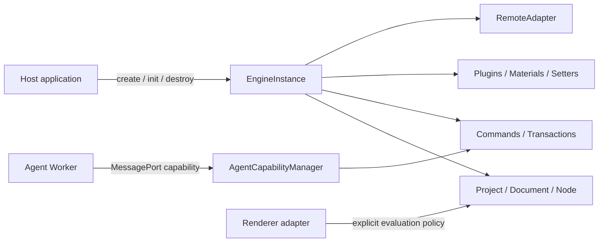

# Architecture Overview

EasyEditor Core is not a bag of global singletons. It is a **host-created, host-owned, and host-disposed state machine**. Schema, edit commands, plugins, remote resources, and Agents receive authority only through explicit boundaries.

## 1. System boundaries



The governing rules are:

1. **Ownership precedes access**: mutable services belong to one `EngineInstance`, not ambient global state.
2. **Validation precedes effects**: Schema, commands, plugin dependencies, and remote requests are checked before mutation.
3. **A transaction has one outcome**: a batch commits as one undo unit or rolls back.
4. **Capabilities are narrower than object references**: an untrusted Agent receives a revocable capability, never `Project`, `Document`, or `Node`.
5. **Disposal is a protocol**: every resource has an owner, an awaitable cleanup result, and retry semantics.

## 2. Explicit instances and lifecycle

New integrations should create an engine through the side-effect-free instance entry:

```ts
import { createEngine, type EngineInstance } from '@easy-editor/core/instance'

const engine: EngineInstance = createEngine({
  // This is also the default; spelling it out records the host decision.
  trustPolicy: 'agentRestricted',
  hostWindow: window,
})

try {
  await engine.init({ designMode: 'design' })
  engine.loadProject(projectSchema, true)
} finally {
  await engine.destroy()
}
```

Lifecycle states are:

```text
created -> initializing -> ready -> disposing -> disposed
                     \-> failed -----^        \-> failed
```

- Concurrent `init()` or `destroy()` callers join the operation in progress.
- Failed initialization rolls owned resources back in reverse order.
- Failed disposal enters `failed`; another `destroy()` retries unfinished cleanup.
- Destroying one instance cannot clear another instance's Project, events, hotkeys, materials, or remote resources.

The root `@easy-editor/core` entry retains `defaultEngine`, `init`, `project`, and other legacy facade exports for compatibility. New code should not use it as the instance entry.

## 3. Trust policies are not sandboxes

| Capability | `agentRestricted` | `legacyTrusted` |
| --- | --- | --- |
| Direct raw-model mutation | Denied | Legacy-compatible |
| Executable Schema / commands | Denied | Allowed for trusted hosts |
| Prototype-extending plugins | Denied with realm-integrity checks | Allowed |
| Remote access | Denied by default | Allowed, still mediated by `RemoteAdapter` |
| Intended use | New constrained hosts and Agent capability endpoints | Dashboards relying on legacy plugins or UMD |

Both policies run in the same JavaScript realm. **Neither provides process, iframe, or SES isolation.** Renderer expression evaluation is a separate policy: allowing evaluation does not place code in a security sandbox.

## 4. Schema boundary

The current Schema protocol version is `1.0.0`. Loading follows this order:

```text
structure -> trust -> version -> migration -> current validation -> normalization -> replacement
```

- `0.0.1` is explicitly migrated to `1.0.0`.
- Future or unsupported versions, missing `componentsTree`, cycles, accessors, and non-plain objects fail before the previous project is unloaded.
- `Project.load()` replaces project data; omitted `id`, `config`, `meta`, or extension fields are not inherited from the prior project.
- `SchemaValidator.prepareWithReport()` reports migrations and normalizations without mutating caller-owned input.

## 5. Commands and transactions

Verifiable writes should enter through `engine.commands` or `engine.transactions`:

```ts
engine.transactions.runOnDocument(
  documentId,
  [
    { type: 'updateProps', nodeId, props: { title: 'New title' } },
    { type: 'moveNode', nodeId, parentId },
  ],
  document => document.revision === expectedRevision,
)
```

The canonical catalog contains:

- `insertNode`, `updateProps`, `removeNode`, `moveNode`
- `replace`, `insertBefore`, `insertAfter`, `wrap`, `unwrap`

Transactions validate commands, document identity, and preconditions before writing. A commit creates one history unit. Failure restores Schema, node identity, selection, history, material counts, and deferred events. Observer failures are reported without pretending the commit did not happen.

## 6. Agent capability boundary

The Agent must not hold engine objects on the UI thread. The recommended flow is:

```text
UI -> request DTO -> Worker
Worker -> snapshot capability -> privacy projection -> same-origin AI gateway
Worker -> strict command parse -> preview -> safe proposal
UI -> explicit confirmation -> trusted Host -> approveAndExecute
Host -> safe result DTO -> UI
```

The host issues a minimal request-scoped grant covering document IDs, component names, command types, extra fields, and size limits. Component types, component props, and extra fields are independent authorities. Props and extras fail closed; only bounded strings, finite ranged numbers, or exact recursively validated objects may enter a command. The Dashboard currently grants only bounded `Text.text` and requires an inserted node to carry a range-checked `$dashboard.rect`.

`preview` fixes the base revision, generated IDs, effects, and expected result. `execute(planId)` checks staleness before commit and exact output afterward. The Dashboard Worker session uses `executionAuthority: 'host'`: peer `execute` fails closed, while only the trusted host can call `approveAndExecute(planId)`. The host looks up its authoritative preview record by plan ID before deriving command counts, operation types, and affected-node counts, so the Worker cannot substitute forged effects for the confirmation summary. The UI never receives the plan ID, node IDs, or commands. Rejection, timeout, dialog close, and stale plans do not silently re-preview or retry.

Before constructing a Worker, the Dashboard host inspects and copies only the newest 10 messages, capped at 2 KiB of UTF-8 per message and 12 KiB total. If an execution error reports a committed mutation or an incomplete rollback, the host returns `outcome: unknown`; callers must re-read the canvas and never automatically retry.

## 7. Remote resources and disposal

Network requests, scripts, styles, WebSockets, timers, and caches should be owned by a `RemoteAdapter` or child resource scope:

1. Check remote policy **before** `fetch`, DOM insertion, or socket creation.
2. Register AbortControllers, nodes, sockets, and timers with the scope.
3. On `destroy()`, stop new work, cancel in-flight work, then clean up in reverse order.
4. Late async completions after disposal must be discarded and cannot re-register resources.

Legacy UMD scripts may mutate global objects or prototypes. Removing a `<script>` element cannot undo those process-level changes, so such code is trusted same-realm code under `legacyTrusted`, not sandboxed content. After a Dashboard instance is destroyed, a new instance in the same realm is not allowed to reclaim an already-loaded UMD global; HMR requires a full page reload. This is a compatibility limit of the legacy adapter, not a Core lifecycle guarantee.

## 8. Verification contract

| Invariant | Test family |
| --- | --- |
| Instance isolation and lifecycle | `engine-isolation`, `engine-lifecycle` |
| Schema migration and failure atomicity | `schema-validation` |
| Transactions and structural commands | `transaction`, `structural-commands` |
| Agent grants, staleness, and transport | `agent-*` |
| Concurrent disposal and retry | `disposal-ledger`, `lifecycle-disposal` |
| Dashboard remote and Worker boundaries | `dashboard-runtime-boundary`, `ai-chat-privacy` |

Architectural claims hold only when lint, public type contracts, runtime tests, and builds pass together.

## 9. Current limitations

- React rendering is implemented today; other frameworks remain extension targets.
- `legacyTrusted` plugins and UMD modules are not reversibly sandboxed.
- Same-realm evaluation policy controls permission to execute, not isolation from malicious code.
- Agent capabilities constrain the set of model actions. The Dashboard confirmation gate helps verify user intent, but it cannot remove prompt injection from projected canvas text or protect a host UI realm already controlled by XSS or malicious scripts.
- Hosts remain responsible for authentication, tenant authorization, rate limits, persistent audit, and real process or iframe isolation.
