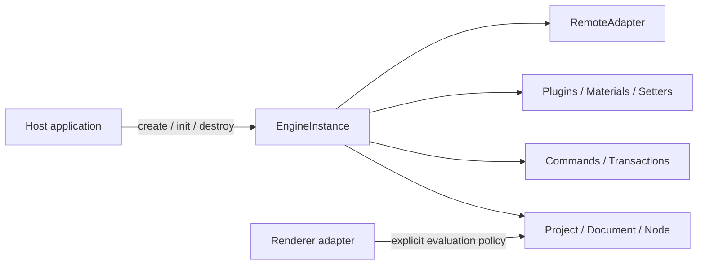

# Architecture Overview

EasyEditor Core is not a bag of global singletons. It is a **factory-created, host-owned, and host-disposed state machine**. The stable framework surface comes only from `@easy-editor/core/instance`; Schema, edit commands, plugins, and remote resources receive authority through explicit boundaries. Agent Runtime design is deferred to a later phase.

## 1. System boundaries



The governing rules are:

1. **Ownership precedes access**: mutable services belong to one `EngineInstance`, not ambient global state.
2. **Validation precedes effects**: Schema, commands, plugin dependencies, and remote requests are checked before mutation.
3. **A transaction has one outcome**: a batch commits as one undo unit or rolls back.
4. **Capabilities are narrower than implementation objects**: plugin Context and host facades expose only the finite authority required for their role.
5. **Disposal is a protocol**: every resource has an owner, an awaitable cleanup result, and retry semantics.

## 2. Explicit instances and lifecycle

New integrations should create an engine through the side-effect-free instance entry:

```ts
import { createEngine, type EngineInstance } from '@easy-editor/core/instance'

const engine: EngineInstance = createEngine({
  // This is also the default; spelling it out records the host decision.
  trustPolicy: 'agentRestricted',
  hostWindow: window,
})

try {
  await engine.init({ designMode: 'design' })
  engine.loadProject(projectSchema, true)
} finally {
  await engine.destroy()
}
```

Lifecycle states are:

```text
created -> initializing -> ready -> disposing -> disposed
                     \-> failed -----^        \-> failed
```

- While any lifecycle operation is in flight, a new `init()` or `destroy()` fails immediately with `LifecycleReentrancyError`; callers must wait for settlement and retry explicitly. `ready.init()` and `disposed.destroy()` are no-ops and neither applies new configuration nor starts a generation.
- Failed initialization rolls owned resources back in reverse order.
- Failed disposal enters `failed`; another `destroy()` retries unfinished cleanup.
- Destroying one instance cannot clear another instance's Project, events, hotkeys, materials, or remote resources.
- `lifecycleState` is a read-only decision source. `disposing`, `disposed`, and `failed` reject new writes and listener acquisition; callers cannot reopen the boundary by assigning the state.
- A generation begins on entry to `initializing` and ends on entry to `disposing` or an initialization rollback. Only those generation boundaries invalidate prior asynchronous mutation tickets, so plugin registration, initialization, or extension work that resumes after destroy/restart cannot commit into the new generation.
- Reusable root services such as Config, Editor, and Designer reactivate only through explicit `init()`. Retained `Document`, `History`, material Registry/Meta, and PluginContext references from an old generation remain permanently tombstoned. PluginContext exposes generation-bound capability views rather than reusable raw service references.
- Same-generation plugin `init()`, `destroy()`, and `extend()` callers join the in-flight Promise. Same-name register, override, and delete operations use an exclusive reservation; a replacement initializes before it atomically replaces the registered runtime.
- Plugin and `RemoteAdapter` lifecycle callbacks must not call the same engine's `init()` or `destroy()`. Direct synchronous re-entry throws `LifecycleReentrancyError`; a restricted PluginContext does not expose either lifecycle method.
- Teardown authority is not exposed as a public boolean; engine-owned services can only be cleaned up by `EngineInstance.destroy()`. Host write authority is suspended before event, material-listener, and component-hook callbacks execute, so callbacks cannot borrow it. Observer-facing state uses detached snapshots instead of backing maps or mutable Error references.
- Under the restricted policy, public transaction APIs reject executable validators. Material transactions restore complete Entry/ComponentMeta state and tombstone replaced metadata only after commit. `MaterialRegistry.getSnapshot()` exposes frozen deterministic verification data without a rollback token.

The root `@easy-editor/core` entry retains `defaultEngine`, `init`, `project`, and other legacy facade exports for compatibility. New code should not use it as the instance entry.

## 3. Trust policies are not sandboxes

| Capability | `agentRestricted` | `legacyTrusted` |
| --- | --- | --- |
| Direct raw-model mutation | Denied | Legacy-compatible |
| Executable Schema / commands | Denied | Allowed for trusted hosts |
| Prototype-extending plugins | Denied with realm-integrity checks | Allowed |
| Remote access | Denied by default | Allowed, still mediated by `RemoteAdapter` |
| Intended use | New constrained hosts | Dashboards relying on legacy plugins or UMD |

`agentRestricted` is a capability, input-validation, and model-mutation policy. A restricted PluginContext is composed from finite root facades that omit engine lifecycle and known reverse-authority fields; its plugin registry is readonly, while the host reads frozen runtime snapshots and generation-bound exports. This narrows the supported API and accidental-authority surface; it is not intended to host malicious code.

Plugins and `RemoteAdapter` implementations execute in the host JavaScript realm and are therefore **trusted extension code**. Neither policy provides process, iframe, Realm, or SES isolation; plugins can still use their own captured closures, imports, and globals. Renderer expression evaluation is a separate policy: allowing evaluation does not place code in a security sandbox.

## 4. Schema boundary

The current Schema protocol version is `1.0.0`. Loading follows this order:

```text
structure -> trust -> version -> migration -> current validation -> normalization -> replacement
```

- `0.0.1` is explicitly migrated to `1.0.0`.
- Future or unsupported versions, missing `componentsTree`, cycles, accessors, and non-plain objects fail before the previous project is unloaded.
- `Project.load()` replaces project data; omitted `id`, `config`, `meta`, or extension fields are not inherited from the prior project.
- `SchemaValidator.prepareWithReport()` reports migrations and normalizations without mutating caller-owned input.

## 5. Commands and transactions

Verifiable writes should enter through `engine.commands` or `engine.transactions`:

```ts
engine.transactions.runOnDocument(
  documentId,
  [
    { type: 'updateProps', nodeId, props: { title: 'New title' } },
    { type: 'moveNode', nodeId, parentId },
  ],
  document => document.revision === expectedRevision,
)
```

The canonical catalog contains:

- `insertNode`, `updateProps`, `removeNode`, `moveNode`
- `replace`, `insertBefore`, `insertAfter`, `wrap`, `unwrap`

The public command catalog is intentionally closed in this phase: third-party plugins cannot register new kernel command kinds. Extend host writes by composing the typed commands above inside transactions rather than injecting arbitrary callbacks into the command executor.

Transactions validate commands, document identity, and preconditions before writing. A commit creates one history unit. Failure restores Schema, node identity, selection, history, material counts, and deferred events. Observer failures are reported without pretending the commit did not happen.

## 6. Agent phase deferred

This phase freezes a framework kernel that is instantiable, disposable, verifiable, transactional, and explicit about trust boundaries. Previous Agent experiments are isolated from this release line, and Core publishes neither an `./agent` nor an `./agent-channel` subpath. Agent Runtime, transport, authorization, and approval protocols will be designed separately after the framework contract is stable.

## 7. Remote resources and disposal

Network requests, scripts, styles, WebSockets, timers, and caches should be owned by a `RemoteAdapter` or child resource scope:

1. Check remote policy **before** `fetch`, DOM insertion, or socket creation.
2. Register AbortControllers, nodes, sockets, and timers with the scope.
3. On `destroy()`, stop new work, cancel in-flight work, then clean up in reverse order.
4. Late async completions after disposal must be discarded and cannot re-register resources.

`RemoteAdapter.init()` and `dispose()` are engine-owned lifecycle callbacks and must not call the same engine's `init()` or `destroy()`. Direct synchronous re-entry is rejected. An adapter must also not capture a raw engine reference and issue a lifecycle call after an `await`.

Legacy UMD scripts may mutate global objects or prototypes. Removing a `<script>` element cannot undo those process-level changes, so such code is trusted same-realm code under `legacyTrusted`, not sandboxed content. After a Dashboard instance is destroyed, a new instance in the same realm is not allowed to reclaim an already-loaded UMD global; HMR requires a full page reload. This is a compatibility limit of the legacy adapter, not a Core lifecycle guarantee.

## 8. Verification contract

| Invariant | Test family |
| --- | --- |
| Instance isolation and lifecycle | `engine-instance`, `engine-lifecycle`, `engine-child-boundaries`, `engine-generation-boundary`, `engine-lifecycle-adversarial` |
| Schema migration and failure atomicity | `schema-validation` |
| Transactions and structural commands | `transaction`, `structural-commands` |
| Concurrent disposal and retry | `disposal-ledger`, `lifecycle-disposal` |
| Finite public entry and capability boundaries | `framework-entry`, `engine-reference-boundaries`, `restricted-mutation-authority` |
| Dashboard remote boundary | `dashboard-runtime-boundary` |

Architectural claims hold only when lint, public type contracts, runtime tests, and builds pass together.

## 9. Current limitations

- React rendering is implemented today; other frameworks remain extension targets.
- Same-realm plugins, `RemoteAdapter` implementations, and UMD modules are trusted extension code; neither `agentRestricted` nor `legacyTrusted` is a malicious-code sandbox.
- Same-realm evaluation policy controls permission to execute, not isolation from malicious code.
- Without AsyncContext-like causal tracking or an isolated Realm/process, same-realm JavaScript cannot reliably distinguish an external host lifecycle call from one issued through a raw engine closure after a lifecycle callback suspends. The latter is a plugin/adapter host-protocol violation, not an isolation guarantee the kernel can reliably enforce.
- Agent Runtime object, transport, and authorization protocols are not stable commitments in this phase.
- Hosts remain responsible for authentication, tenant authorization, rate limits, persistent audit, and real process or iframe isolation.
